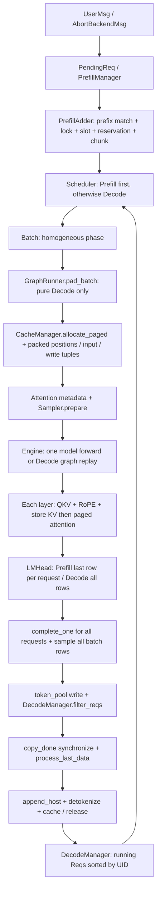

# C7 阶段 0：基线冻结、调用链与设计

日期：2026-10-28（Asia/Shanghai）。本轮仅做阶段 0 和阶段 1，不接通 Mixed 模型执行。

## 源码与环境

- 原始 HEAD：`9a91cfafe754aa85daee49998176275667eb58f2`，与任务指定调研基线一致。
- 初次检查 `git status --porcelain=v1` 无输出；没有覆盖已有修改。
- 开发分支：`c7/mixed-batching-stage1`；`main` 保留原始基线。
- 工作区及祖先目录没有适用的 `AGENTS.md`。
- 附件仅找到本轮任务文本；`mini_sglang_optimization_research_20261025(1).md` 未提供/未找到，没有假称阅读 C7 报告。
- 默认 `/usr/bin/python3` 3.12.3 没有 torch/pytest/FlashInfer。复用邻近仓库的只读环境
  `/home/wty238388/ai-infra/Serving_V1/mini-sglang/.venv`，不安装、不升级依赖，不改变其 editable 安装。
  必须设置 `PYTHONPATH="$PWD/python"`，否则默认导入邻近仓库的 minisgl。
- Python 3.12.14，torch 2.9.1（CUDA 12.8），FlashInfer 0.6.16.post3，transformers 4.57.3，
  triton 3.5.1，sgl-kernel 0.3.21，apache-tvm-ffi 0.1.14.post1，quack-kernels 0.6.5，
  pytest 9.1.1、pytest-cov 7.1.0。符合项目声明的核心版本约束。
- WSL2 Linux；RTX 3060 Laptop 6144 MiB，SM 8.6，BF16 可用。
  `nvidia-smi` 的 CUDA 12.9 是驱动兼容能力；实际 torch CUDA 和 nvcc 均为 12.8。
- 模型使用已有本地 `/home/wty238388/ai-infra/models/Qwen3-0.6B`，不下载新模型。
- 原始证据：[环境与真实 API](evidence/environment.txt)、[完整依赖](evidence/dependencies.txt)。

## 原系统数据流



`overlap_loop` 会先调度/发射下一轮，再处理上一轮 CPU 输出。`Req` 对象是共享可变状态，
`Engine.forward_batch` 在返回时已同步修改 `cached_len/device_len`，而 GPU 工作和 CPU 回传尚可在飞。
`ForwardInput` 因此持有输入/写回映射张量，不能事后从变化的 Req 重算旧批次索引。

## 关键不变量与实际语义

1. 调度前 `extend_len = device_len - cached_len > 0`；Decode 必须等于 1。
   Query 按请求顺序连续打包，位置是该请求的 `[cached_len, device_len)`。
2. `device_len` 是本轮 Query 结束位置；`cached_len` 是已经有效的历史 KV 长度；
   `complete_one()` 将前者赋给后者，再令前者加 1，为下一生成 Token 预留位置。
3. `ChunkedReq` 沿用 `complete_one()`，其 +1 是原实现的占位状态；后续 Chunk 从旧 `cached_len` 续算，
   不从这个 +1 的位置续算。`PendingReq` 持有完整输入，Chunk 的 Req 只持有输入前缀。
4. `CacheManager.match_req` 只匹配到 `input_len - 1`，所以 Prefix 全命中也至少计算一个 Query。
5. Prefill 先检查请求槽和完整未缓存输入 + 输出的 KV 容量，再锁 Prefix，并再次检查可用容量。
   `reserved_size` 包含活跃 Decode 剩余输出以及每个请求的 `page_size - 1` 预留。
   不减少这些预留，不另写资源分配器；多个 Prefill 共用预算，Chunk 不做对齐。
6. 续算的 Chunk 复用 table_idx/cache_handle，不再分配请求槽，不重复锁 Prefix。
   阶段 1 不改变 cache_req、lazy free、EOS、Abort 或 overlap 的资源释放时机。
7. 原实现实际上对**所有** Batch 行采样，包括中间 Chunk；中间 Chunk 在结果处理时跳过，
   `_make_write_tuple` 因 `can_decode=False` 将其写到该行的 -1 位置。
   C7 必须消除这些虚假采样/写回，但本轮只定义显式映射，不提前改 Sampler/Engine。
8. 最终 Prefill 与 Decode 都需要采样；中间 Prefill 不需要。不能用 `query_len==1` 区分请求阶段。
   采样掩码必须在调度时冻结，不能根据完成后可能变化的 `can_decode` 推断。
9. `filter_reqs` 通过 `req.can_decode` 决定活跃集合，Chunk 永不加入。Prefix 插入当前依赖
   `batch.is_prefill`，Mixed 接通时必须改成每请求阶段判断。
10. Prefix cache 的 `check_integrity` 自身目前为空实现；CacheManager 的总页数检查仍有效，
    不能据此宣称 radix 引用计数已全面验证。

## 所有 phase 分支及后续风险

| 文件 / 逻辑 | 原行为 | Mixed 接通时的要求 |
| --- | --- | --- |
| `core.py: Batch.is_prefill/is_decode` | 两种互斥阶段 | 增加独立 mixed，不能冒充任一纯阶段 |
| `scheduler/prefill.py`, `decode.py` | 各自创建同质 Batch | Decode 在前、Prefill 在后，UID 稳定 |
| `scheduler/scheduler.py: _process_last_data` | Chunk 跳过；仅纯 Prefill 缓存前缀 | 采样压缩行映射 + 每请求阶段 |
| `layers/embedding.py: LMHead.forward` | 只有纯 Prefill 选择各请求最后 hidden row | Mixed 也按有效采样请求的最后 Query 行 gather |
| `attention/fi.py: prepare_metadata` | 纯 Decode 用 decode wrapper，其余 prefill wrapper | Mixed 明确使用 paged prefill wrapper，核对未 padding 的长度 |
| `attention/base.py: HybridBackend.forward/prepare_metadata` | 非 Prefill 一律走 Decode backend | 首版要求显式 `fi`，拒绝 hybrid/auto |
| `attention/trtllm.py: forward` | 非 Prefill 一律 Decode kernel | 首版拒绝该组合 |
| `engine/graph.py: can_use_cuda_graph` | 仅 `is_decode` 可 graph | Mixed 保持 eager；不改变 sizes/pool/capture |
| `engine/graph.py: _capture_graphs` | 人造纯 Decode Batch | 不给默认基线/graph dummy 引入新映射工作 |
| `engine/engine.py`, `sample.py`, write tuple | 虽无 phase 分支，默认一请求一采样行 | 同样需要阶段 3 显式改造 |

枚举命令：

```bash
rg -n '\.phase\b|is_prefill|is_decode|ChunkedReq|complete_one|Batch\(' python tests
```

## FlashInfer 核对

已用 `inspect.signature` 检查**安装的** 0.6.16.post3，而非套用在线最新版：

- `BatchPrefillWithPagedKVCacheWrapper(..., kv_layout="NHD", backend="fa2")` 可用；
  plan 支持现有代码使用的 `qo_indptr/paged_kv_indptr/paged_kv_indices/paged_kv_last_page_len`、
  `head_dim_qk`、`seq_lens`、`q_data_type/kv_data_type`、`causal=True` 和 `non_blocking=True`。
- Decode plan 有 `**kwargs`，仅看签名不足以证明 kernel 可用；基线 smoke 才验证真实执行。
- 当前 `fi.py` 将 KV 展平为 `[physical_tokens, 1, local_kv_heads, head_dim]`，wrapper 的 page_size 固定为 1；
  系统 page_size 是管理粒度。首版主动只接受系统 page_size=1，减少验证组合。
- Q 为 `[sum(query_lens), local_qo_heads, head_dim]`；local heads 来自 TP 分配。
  `out_loc = page_table[input_mapping]`；先 store 本层新 K/V，再从该层 `k_cache(layer_id)/v_cache(layer_id)` 读。
- query prefix sum 来自 extend_len；KV prefix sum 来自 device_len；物理 indices 按请求拼接完整历史及本轮 KV；
  page_size=1 时 last_page_len 恒为 1。已有分支可表示变长混合 Query，但尚未做 Mixed 数值比较。
- RoPE 使用绝对 positions；FlashInfer pos encoding 为 NONE，避免重复 RoPE。
- wrapper/workspace 为 backend 长生命周期对象，metadata 每批创建并在首层 plan 一次。
  `last_event.synchronize()` 保护下次 plan 不覆盖 pinned host staging buffer；不能移除。
  同一 engine stream 上顺序执行各批，各层复用相同 plan；本轮不改生命周期。

设计参考：[Sarathi-Serve §4.2 / Algorithm 3](https://www.usenix.org/system/files/osdi24-agrawal.pdf)
先容纳活跃 Decode，再用剩余预算加入 Prefill。FlashInfer
[当前 attention 文档](https://docs.flashinfer.ai/api/attention.html) 已为 0.7.2.post1，
所以接口判断以安装 wheel 的审计输出为准。未推断 RTX 5060 Ti 的 kernel 支持。

## 阶段 1 最小设计和文件范围

- `core.py`：独立 `mixed` phase、Req 的采样意图、按请求冻结的 CPU `BatchLayout`。
  保存 UID、请求槽、请求阶段、Q/KV 长度、sample_mask，推导 qo_indptr、采样请求行及 packed hidden 行。
  只有新调度路径构建 layout，默认 baseline 不做这些快照/校验。
- `scheduler/mixed.py`：GPU 无关的选批入口。全部 Decode 按现有 UID 顺序在前，
  `remaining_budget=max(0,total_budget-num_decode)` 交给原 PrefillManager；不重写准入逻辑。
- Decode 数等于或超过预算：所有 Decode 仍执行，Prefill 为零；超过时只放宽该轮的有效预算至 Decode 数量，
  不截断活跃集合、不永久修改配置。TP>1 首版不支持，之后若放开还需检查通信 buffer 的 max_forward_len。
- `scheduler/config.py`、`server/args.py`：默认关闭的明确开关，开启只接受 TP=1、显式 fi、page_size=1、正预算。
- `scheduler/scheduler.py`：分离选批与 GPU prepare，关闭时仍按原表达式选批。
  **阶段 1 的服务启动在加载模型前拒绝开启 Mixed；prepare 对新 layout 也防御性拒绝。**
  只有 CPU 选批入口可运行新策略，避免将尚未适配的 LMHead/Sampler/输出处理接入生产 Forward。
- `scheduler/prefill.py`：仅声明中间 Chunk 不应采样，原 baseline 执行保持不变。
- `tests/core/test_mixed_scheduler.py`：真实 Prefill/Decode 管理器 + CPU Tensor；只替代 pinned-copy 储存边界，
  不 mock 选批/准入/续算逻辑。另覆盖实际 CPU Prefix match 和资源回滚。
- 本轮不修改 Attention、LMHead、Engine、Sampler、Graph 或 CacheManager 实现。

## 验证方案

1. 修改调度前运行原有 CPU cache tests 和小模型基线；记录首个 PATH 缺少 ninja 的失败，再补全 PATH 重试。
2. 阶段 1 CPU 测试禁用 CUDA 可见性，覆盖任务要求的十类场景，并检查中间 Chunk、采样索引、
   物理页/槽位映射、容量预留、锁失败回滚、开关回退、超预算 Decode、Abort 及快照不随 Req 修改。
3. 修改后回归相同 CPU 测试和相同 baseline smoke，与冻结输出/批次 trace 对照。
4. Mixed Attention 输出、logits、Token、Graph/Overlap 组合、EOS/Abort 在飞资源安全仍属阶段 2～4，
   不用 CPU 选批测试替代这些验收。阶段 1 验证不等于 C7 端到端完成。

实际测试结果和续接步骤见 `stage1-results.md`（阶段 1 完成后写入）。

## 阶段 0 实测结果

- `tests/core/test_cache_allocate.py`：6 passed，CUDA 不可见。
- 首次 baseline Eager 运行因 PATH 未包含环境 bin，JIT 找不到 ninja；失败日志保留在
  [baseline-initial-path-failure.txt](evidence/baseline-initial-path-failure.txt)。
  补全 PATH 即可，无需改代码或安装依赖。
- BF16 Qwen3-0.6B，TP=1，fi，page_size=1，512 KV tokens，max_seq_len=256，2 请求，
  chunk budget=16，每请求 greedy 输出 4 Token。
- [Eager / 无 Overlap](evidence/baseline-eager-no-overlap.txt)：PASS，峰值分配 1,423,837,184 bytes。
- [Decode Graph sizes [1,2] / Overlap](evidence/baseline-graph-overlap.txt)：PASS，
  纯 Prefill 为 Eager，纯 Decode 确实使用 Graph，峰值分配 1,432,887,296 bytes。
- 两种配置输出完全一致：`[12095,13,576,6722]` 和 `[44801,279,3409,23811]`。
  请求槽、Decode/Pending 集合及 CacheManager 总页数检查通过；这不是 Mixed 正确性验证。
- 无阶段 1 的阻断性问题，继续实现 CPU 选批和布局快照。

复现命令（在本仓库根目录）：

```bash
export PATH="/home/wty238388/ai-infra/Serving_V1/mini-sglang/.venv/bin:$PATH"
export PYTHONPATH="$PWD/python"
python scripts/c7/audit_env.py
CUDA_VISIBLE_DEVICES='' python -m pytest -o addopts='' -p no:cacheprovider -q tests/core/test_cache_allocate.py
python scripts/c7/baseline_smoke.py --model /home/wty238388/ai-infra/models/Qwen3-0.6B --disable-overlap
python scripts/c7/baseline_smoke.py --model /home/wty238388/ai-infra/models/Qwen3-0.6B --graph-bs 1 2
```
