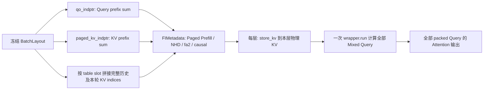

# C7 阶段 2：Mixed Paged Attention 接入与数值验证

日期：2026-10-28（Asia/Shanghai）。阶段 2 完成后停止，未接通服务端 Mixed Forward。

## 源码、环境与范围

- 进入阶段 2 时 HEAD 为 `b4d2d7aa0bfa181979f552daec6331b87d041781`，工作区干净；
  继续在 `c7/mixed-batching-stage1` 开发分支保存阶段提交，原始 `main` 不变。
- 重新运行环境审计：[stage2-environment.txt](evidence/stage2-environment.txt)。
  Python 3.12.14、torch 2.9.1 / CUDA 12.8、FlashInfer 0.6.16.post3、SM 8.6 RTX 3060 Laptop / 6 GB，
  BF16 可用。复用既有虚拟环境和本地 Qwen3-0.6B，未安装/升级核心依赖。
- 生产代码只修改 `python/minisgl/attention/fi.py`。新增 GPU 测试、数值汇总脚本、文档和证据。
  未修改 Scheduler 的执行门禁、LMHead、Engine、Sampler、Graph、KV allocator 或 Prefix Cache 实现。
- [FlashInfer 官方 Attention 文档](https://docs.flashinfer.ai/api/attention.html) 的 Paged Wrapper 定义
  用于核对数据布局；真实接口以本地安装的 **0.6.16.post3** 签名和执行结果为准，未采用在线新版专有功能。

## 实现与数据流

`FlashInferBackend.prepare_metadata` 对独立 `mixed` phase 分派至 `_prepare_mixed_metadata`；
纯 Prefill / Decode 的元数据构造沿用原实现。

新入口验证 TP=1、系统 page_size=1、存在调度快照、Batch 不含 padding、请求阶段同时含 Prefill/Decode，
并检查快照中的 UID、table slot、Query/KV 长度与当前待执行请求一致。
槽位/序列长度需落在 page_table 范围内，KV 累计长度需适合 int32；positions/out_loc 数量需等于 packed Query 总数。
非法布局在 plan/store/run 前明确报错。物理页值范围及实际 positions 内容在 GPU 测试中检查；
生产路径依赖原 allocator 的页值正确性，不额外插入 GPU `.item()` 同步。



指定示例：

```text
Query lengths          = [1, 1, 1, 125]
KV lengths             = [501, 1001, 2001, 125]
qo_indptr              = [0, 1, 2, 3, 128]
paged_kv_indptr         = [0, 501, 1502, 3503, 3628]
paged_kv_indices        = 3628 个实际物理 token 页索引（int32 CUDA）
paged_kv_last_page_len  = [1, 1, 1, 1]
positions              = [500, 1000, 2000, 0, 1, ..., 124]
Q shape                = [128, 16, 128]
K/V input shape        = [128, 1024]（来自 packed QKV 的非连续行跨度切片）
flattened KV per layer = [8192, 1, 8, 128]
```

wrapper 明确选现有 `prefill_wrapper`，即使 Mixed 中所有 Query 长度均为 1 也不改用 Decode Wrapper。
混批不引入 CUDA Graph、不加 dummy request。复用原每层 store/run、plan 和 workspace/event 逻辑：
新批次首层 plan 一次，后续层复用；保留 plan 前 `last_event.synchronize()` 保护 pinned staging buffer。
所有层按一个 engine stream 顺序运行，一个 Batch 的层全部提交完才提交下一 Batch。

## 测试方法和覆盖

新文件：`tests/attention/test_mixed_flashinfer.py`。使用真实 `MHAKVCache`、store kernel、
FlashInferBackend 和安装的 FlashInfer fa2；不 mock Attention kernel、plan 或 store。
plan 计数测试仅包一层计数器，仍调用真实 plan。

所有张量固定 seed；输入先量化成 BF16，再生成独立的 FP32 CPU 参考结果。
参考从每请求的逻辑 K/V 构造，不从 FlashInfer 的 indices 或 GPU cache 反向读取，
显式展开 GQA 并计算 `softmax(QKᵀ / sqrt(head_dim)) V`。
Query 行 j 的 causal mask 只允许 `key_position <= cached_len + j`；计算每个 Query 行并拼接，非只检查末行。

| 用例 | 实际验证 |
| --- | --- |
| 指定 Q/KV 长度，两个 seed | 随机非连续物理页、非连续请求槽、两层独立 KV、FP32 参考与逐请求 FlashInfer 对照 |
| 1 Decode + 7 Token cached Prefill | 非对齐 Chunk、历史位置偏移 |
| 多 Decode + 多 Prefill | 不同缓存长度、同轮共享 Packed Query |
| 全部 Query 长度为 1 的 Mixed | 仍明确使用 Prefill Wrapper，区分阶段与长度 |
| 三请求共享 16 Token 物理前缀 | 共享历史只读、后续新增 KV 不重叠、不同请求后缀独立 |
| 修改请求 A 历史 V | A 输出改变；B 输出逐 bit 不变，并重新匹配 FP32 参考 |
| 末尾新 V=100 的解析用例 | 早期 Query 输出严格为 0；最后 Query 输出接近 100/7，禁止读取未来 Token |
| 同一 Batch 两层、多 Batch plan | 每批只 plan 一次；后续批不同长度正确重新 plan |
| 真实 Radix 命中与两轮续算 | 命中 32 Token；Prefill Query 7→1、KV 39→40；第二轮保留并读取第一轮实际写入的 GPU KV |
| 提交多个 Batch 后延迟核对 | Mixed→纯 Decode→纯 Prefill→Mixed，共享 workspace；提交所有层后才做 CPU 输出核对 |
| 实际 `AttentionLayer.forward` | packed QKV split、绝对位置 RoPE、与独立 FP32 NeoX RoPE + Attention 参考对照 |
| 10 类非法布局 | 缺 layout、padding、陈旧请求、错误阶段、槽/长度越界、positions/out_loc 数量错误、page_size/TP 不支持 |

新 K/V 的目的位置先填 NaN；若漏 store 或读取错误层/未写区域，会出现非有限值或数值失败。
常规两层用例还逐元素精确比较 store 后整段历史及新 K/V，`atol=rtol=0`。
共享前缀之外的物理映射随机、追加位置互不重叠；参考逻辑输入与物理布局独立。

延迟核对用例使用独立 CUDA stream 模拟 Engine，先准备不同批次缓存快照，再在该 stream 上依次恢复缓存、
plan/store/run 和保存 GPU 输出。测试调用方不在各批之间额外 `.cpu()` / `.item()` / synchronize，
**后端原有的 event 同步仍然保留**。这验证既定的单 engine stream 调用方式，不支持跨批层交错执行。

## 实测结果

- GPU：**22 passed，0 skipped，0 failed**；[完整最终日志](evidence/stage2-attention-tests.txt)。
- 共 **39 次数值比较，超出既定容差的元素数为 0**；[机器汇总](evidence/stage2-numeric-summary.txt)。
- CPU：阶段 1 的 **57 项全部通过**；[回归日志](evidence/stage2-cpu-regression.txt)。
- Qwen3-0.6B 基线 Eager / 无 Overlap、Decode Graph [1,2] / Overlap 两组都通过，
  与原始基线的选批 trace、输出 Token、PyTorch 峰值分配和完成检查一致；
  [对照结果](evidence/stage2-baseline-comparison.txt)、[Eager](evidence/stage2-baseline-eager-no-overlap.txt)、
  [Graph](evidence/stage2-baseline-graph-overlap.txt)。纯 Decode 确实走 Graph，纯 Prefill 仍为 Eager。
- Black / Ruff / Git whitespace 检查及依赖未变检查见 [stage2-checks.txt](evidence/stage2-checks.txt)。

| 比较组 | 次数 | 最大绝对误差 |
| --- | ---: | ---: |
| 常规 Mixed vs FP32（6 场景 × 2 层） | 12 | 0.0094058514 |
| Mixed vs 逐请求 FlashInfer 后拼接 | 6 | 0.0078125000 |
| 历史 V 扰动后 vs FP32 | 1 | 0.0159626007 |
| V=100 的 causal 解析用例 | 1 | 0.0267848969 |
| 连续重新 plan | 6 | 0.0079474449 |
| Radix 命中、真实 KV 延续 | 4 | 0.0065071583 |
| 多 Batch 延迟核对 | 8 | 0.0081202984 |
| 实际 AttentionLayer / RoPE | 1 | 0.0041625500 |

预定且未变的验收公式是 `abs(actual-reference) <= 0.02 + 0.02 * abs(reference)`，
不是只要求绝对误差小于 0.02。V=100 用例最后一行参考值为 100/7，BF16 误差约 0.0268，
满足同一公式；没有事后调整容差。接近零的参考值会放大单独的相对误差（原始日志完整记录），
因此按公式逐元素检查；汇总里的 P99 是各次比较 P99 的最大值，并非所有元素合并的全局 P99。

GPU 测试进程最大 PyTorch allocated 为 **556,672,000 bytes**，reserved 为 **587,202,560 bytes**；
不包含 Windows/驱动占用，不是设备总显存，也不是 Serving 性能数字。
用于压力检查的缓存快照有意增加显存，但仍适合 6 GB 环境。

### 运行过程和失败信息

首次 20 项 GPU 测试全部通过：[初轮日志](evidence/stage2-attention-initial.txt)。
补充真实历史 KV 延续、延迟核对与 RoPE 后 22 项通过：[扩展日志](evidence/stage2-attention-extended.txt)。
随后将延迟用例加强为 Mixed/Decode/Prefill 切换并完成最终 22 项运行。
本阶段没有功能或数值失败；Ruff 初次发现一处导入排序，已修正。
FlashInfer 导入时产生 7 条第三方 CuTe/Blackwell 模块弃用警告，完整保留在日志，未因此升级依赖或屏蔽警告。
证据日志仅去除行尾空白以通过 Git whitespace 检查，不改变数值、警告或测试结果。

GPU 用例在无 CUDA 机器上会显式 skip；这不能算 GPU 验证通过。
本次实际 RTX 3060 环境没有 skip。汇总脚本会拒绝包含失败/跳过的测试结果或缺少数值证据的日志。
CPU 和 GPU 套件分开进程运行，保留阶段 1 的“CPU 用例不初始化 CUDA”断言。

## 复现命令

在当前仓库根目录，保留解释器、PATH 和 PYTHONPATH 的明确选择：

```bash
export PATH="/home/wty238388/ai-infra/Serving_V1/mini-sglang/.venv/bin:$PATH"
export PYTHONPATH="$PWD/python"
python scripts/c7/audit_env.py

# 独立 CPU 进程
CUDA_VISIBLE_DEVICES='' python -m pytest -o addopts='' -p no:cacheprovider -q \
  tests/core/test_mixed_scheduler.py tests/core/test_cache_allocate.py

# 独立 GPU 进程（不要在这行设置 CUDA_VISIBLE_DEVICES=''）
python -m pytest -o addopts='' -p no:cacheprovider -q -s \
  tests/attention/test_mixed_flashinfer.py > docs/c7/evidence/stage2-attention-tests.txt 2>&1
python scripts/c7/summarize_attention.py docs/c7/evidence/stage2-attention-tests.txt

# 保持 Mixed 开关关闭的基线回归，各自独立进程
python scripts/c7/baseline_smoke.py --model /home/wty238388/ai-infra/models/Qwen3-0.6B --disable-overlap
python scripts/c7/baseline_smoke.py --model /home/wty238388/ai-infra/models/Qwen3-0.6B --graph-bs 1 2

uvx --from black==24.10.0 black --check python/minisgl/attention/fi.py \
  tests/attention/test_mixed_flashinfer.py scripts/c7/summarize_attention.py
uvx --from ruff==0.11.7 ruff check python/minisgl/attention/fi.py \
  tests/attention/test_mixed_flashinfer.py scripts/c7/summarize_attention.py
git diff --check
```

## 当前边界和下一阶段

- 服务端两处阶段 1 门禁仍在；Attention 的隔离调用不经过 Scheduler→Engine→Sampler。
  不能把本轮结果称为完成真正的 Mixed 模型 Forward 或端到端 Serving。
- 尚未验证 Mixed logits、greedy Token、有效采样行写回、EOS/max_tokens/ignore_eos、
  在飞 Abort/Overlap 回收、最终 Prefix 插入/引用计数和所有请求完成后的页回收。
  Radix 用例只模拟请求长度前进，没有调用 Sampling 或声称输出生命周期正确。
- 仅验证 TP=1、系统 page_size=1、BF16、16 Q / 8 KV heads、head_dim=128 的 fi/fa2。
  未验证其他 dtype/head 组合、其他 backend、TP>1、RTX 5060 Ti；目标机需要重新运行检查。
- 既有 plan 的 initialized 标志只适用于同一 Batch 连续各层；
  不允许 A 层 0→B 层 0→A 层 1 这种会覆盖共享 wrapper plan 的外部调用方式。
  当前 Engine 按完整 Batch 提交所有层，本轮没有改变这一约束。
- 下一步阶段 3：LMHead 按 sample_token_indices gather；Sampler 参数和输出只含 sample_req_indices；
  write tuple/token_pool/CPU 结果处理共用压缩行映射；中间 Chunk 不 Sampling、不写虚假 Token；
  按每请求阶段处理 Prefix 插入；审计并验证 overlap 的 EOS/Abort 延迟释放与槽位复用。
  只有整个新执行链正确后才更新门禁与 CLI 提示。阶段 4 再扩大端到端配置矩阵，仍不预设性能收益。

## 下一轮提示词

```text
工作区 /home/wty238388/ai-infra/Serving_V1/mini-sglang-mixedBatch，当前开发分支 c7/mixed-batching-stage1。
先核对 git status/log，再读 docs/c7/stage0-audit.md、stage1-results.md、stage2-results.md。
阶段 2 已完成 Mixed FlashInfer 元数据和真实 GPU 数值验证：22 GPU 用例、39 次比较通过；
阶段 1 的 57 项 CPU 回归通过。服务端执行门禁仍保留，Mixed 还不能经过原 Engine/Sampler 运行。
本轮执行阶段 3：明确消费 BatchLayout 的 sample_req_indices/sample_token_indices，
适配 LMHead、Sampler.prepare/sample、Engine、write tuple、token_pool、CPU 结果映射和每请求 Prefix 处理。
中间 Chunk 不采样、不输出、不写虚假 Token；Decode/最终 Prefill 正确采样，保持 EOS/max_tokens/ignore_eos。
审计上一轮结果尚在飞时的 EOS/Abort/资源回收，验证槽位复用、KV/Prefix 引用、重复完成和 double free。
先完成可验证实现再撤销两处门禁；默认关闭、基线路径、纯 Decode Graph 和全部同步/容量预留保持原语义。
不升级核心依赖；复用原环境 bin/PYTHONPATH，CPU/GPU 套件分开进程。
首版仍只支持显式 fi、TP=1、page_size=1，Mixed Eager，不引入其他优化。
按阶段提交，记录命令/结果/失败和未验证项；不要自动开展阶段 5 性能实验。
```
