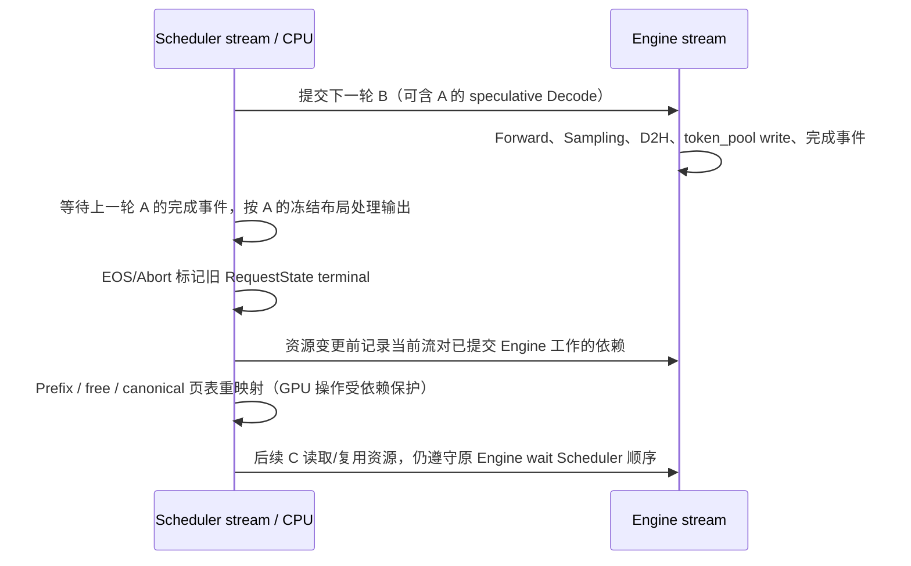

# C7 阶段 3：压缩采样、结果写回与请求生命周期

收尾日期：2026-10-29（Asia/Shanghai）；下列主要实测日志产生于 2026-10-28。
阶段 3 已接通真实模型 Mixed Forward 并完成功能/生命周期验证。
**不能据此声称所有 logits 数值对照均通过**：跨 Batch 形状及不同 KV 来源的严格对照存在已复现差异，见下文。
本轮不开展阶段 5 性能实验，阶段 4 的完整配置矩阵仍待后续执行。

## 审计与改动范围

进入阶段 3 的 HEAD：`486f1ef`，工作区干净。继续使用 `c7/mixed-batching-stage1` 开发分支，
`main` 仍为原始 `9a91cfa`。环境为 Python 3.12.14、PyTorch 2.9.1 / CUDA 12.8、
FlashInfer 0.6.16.post3、RTX 3060 Laptop 6 GB；核心依赖没有安装或升级。
[环境证据](evidence/stage3-environment.txt)，最终依赖/静态检查见 [stage3-checks.txt](evidence/stage3-checks.txt)。

| 文件 | 关键改动 |
| --- | --- |
| `core.py` | Batch 增加 GPU `sample_hidden_indices`，仅新路径准备 |
| `layers/embedding.py` | 非 Decode 的新布局按有效采样 hidden 行 gather；纯 Decode Graph 保持原路径 |
| `engine/sample.py` | prepare 只读取 sample_req_indices 对应参数，sample 实现保持原样 |
| `engine/engine.py` | 有效 logits 行数校验、零采样跳过 Sampler、中间 Chunk 只前进 cached_len |
| `scheduler/lifecycle.py` | 请求槽一代所有权 RequestState；跨 Chunk 共享、终止后旧结果失效 |
| `scheduler/scheduler.py` | 压缩 write tuple、独立结果映射、快照终止判断、流依赖、Prefix 重映射与资源释放 |
| `server/args.py` | 更新已可运行的 Mixed CLI 帮助；默认仍关闭 |
| `attention/fi.py` | 仅更新已过时的阶段门禁说明，没有改 Attention 实现 |
| `tests/core/`、`tests/engine/` | CPU 采样/生命周期契约、真实小模型和 GPU 在飞资源测试 |
| `scripts/c7/` | Mixed smoke、跨批形状 logits 诊断、Prefix KV 来源诊断 |

原 CacheManager、Prefix Cache、DecodeManager、GraphRunner、CUDA Graph sizes/pool/capture 均未修改。
没有引入动态 Budget、Chunk 对齐、FP8、Cascade、Ragged 或其他调度优化。

## 执行与采样契约

新策略选出的纯 Prefill、纯 Decode、Mixed 均携带冻结 BatchLayout，关闭开关的 Batch.layout 仍为 None。

1. Scheduler 在 GPU prepare 时创建 sample_hidden_indices，值来自 layout.sample_token_indices。
2. LMHead 对 Mixed / 新路径 Prefill 只投影这些 hidden 行；中间 Chunk 不占 logits 行。
   纯 Decode Eager/Graph 使用原输出路径，Graph replay 仍只返回真实请求行，dummy 不参与采样。
3. Sampler.prepare 只读取 sample_req_indices 的温度、top_k、top_p；顺序与 LMHead 行一致。
4. Engine 用冻结 kv_lens 前进请求：采样请求 `device_len=kv_len+1`；中间 Chunk `device_len=cached_len=kv_len`，
   不增加虚假生成 Token。采样数为零时完全不调用 Sampler，返回空输出。
5. `_make_write_tuple` 只包含采样请求的 `(table_idx, kv_len)`，不存在中间 Chunk 的 -1 写回。
6. GPU 与 CPU 输出行共用 sample_req_indices；CPU 只向这些 UID append_host / send_result。
   最后 Prefill 加入 Decode，中间 Chunk 留在 Pending。

真实 Qwen3-0.6B trace 示例：

```text
phase=mixed  query_lens=[1,15]  sample_mask=[true,false]  sample_count=1
```

同一轮只有一个 Engine.forward_batch；所有请求共享同一模型 Forward 的各层计算。
测试中的逐请求参考和诊断控制组不是运行实现的一部分。

## Overlap 与资源正确性

### 独立于 Req 可变长度的结束判断

原 `_process_last_data` 使用 req.can_decode，但下一轮 Engine 可能已经改变同一 Req 的长度。
新路径按该轮快照 `kv_len + 1 >= max_device_len` 判断 max_tokens，再按 ignore_eos 决定 EOS。
EOS 后可能已多算一轮，旧结果不再 append / send / cache / free，因此 finished 只发送一次。

RequestState 以请求槽的一代所有权为单位：续算 Chunk 换 Req 对象但继续共享同一 State；
终止后从 active 删除，旧 ForwardInput 仍持有已 terminal 的 State。
槽位甚至 UID 被复用后，旧异步输出仍会被旧 State 拦截，不影响新所有者。
Abort 还会查 active State，覆盖最终 Token 已提交、请求已被 DecodeManager 移除但 CPU 尚未处理的情况。

### GPU 使用与 CPU 所有权分别保护

CPU terminal 标记解决逻辑重复完成；资源变更前的当前流 wait_stream(engine.stream) 保护 GPU 使用寿命。
Overlap 调度流上的页表重映射、Prefix 索引操作、释放和后续槽位/页复用，均排在已提交的 Engine 工作之后。
正常非 Overlap 模式本来就在 Engine stream 上，无需自等待。

原 Engine 的 copy_done_event 在 D2H 后记录，Scheduler 的 token_pool 写回还在其后。
新路径在写回后重新记录该事件，防止 ForwardInput 的 GPU 索引张量在最后一次使用前被回收。
没有删除原同步，没有把 Mixed 全部改成串行调度，没有减少容量预留。
新增流依赖的开销尚未作为性能实验测量。



### Prefix 去重的两个修复

- `cache_req` 可能释放本请求重复物理页、保留其他请求的 canonical 页。
  新路径把活跃请求页表指向这些保留页，避免继续引用已释放页。
- `lazy_free_region` 暂存的是旧页表**视图**；若提前重映射，会把 canonical 页误当成重复页释放。
  因此先让 region 的 finally 消费旧视图，再在同一流中重映射。
- 活跃 Prefill 入缓存只使用该 Prefill 的冻结 kv_len，不把下一轮 Decode 已前进的 cached_len 一并插入。
  使用浅拷贝 Req 传给原 cache_req，再更新真实请求的 handle；Decode 私有尾部继续保留。
  完成/Abort 时才按实际已计算、且有 host Token 对应的 cached_len 完整缓存/回收。

## 实际验证结果

| 验证 | 结果 | 证据 |
| --- | --- | --- |
| CPU 调度、缓存、采样及生命周期 | **73 passed，0 skipped** | [CPU 日志](evidence/stage3-cpu-tests.txt) |
| 真实 Qwen3-0.6B GPU 执行/生命周期 | **12 passed，0 skipped** | [GPU 日志](evidence/stage3-execution-tests.txt) |
| 阶段 2 Attention 回归 | **22 passed；39 次比较无超差** | [日志](evidence/stage3-attention-tests.txt)、[汇总](evidence/stage3-attention-summary.txt) |
| 关闭开关的原始基线回归 | Eager/无 Overlap、Graph/Overlap 均通过；原 trace/Token/峰值分配一致 | [基线对照](evidence/stage3-baseline-comparison.txt) |
| 开启开关的小模型 smoke | Eager/无 Overlap、Graph/Overlap 均通过，存在真正 Mixed Forward | [Eager](evidence/stage3-mixed-eager-no-overlap.txt)、[Overlap](evidence/stage3-mixed-graph-overlap.txt) |
| 相同 Packed 形状，3 请求 × 3 输出 logits 对照 | 9 组逐位一致，max_abs=0；仍使用 atol=0.1/rtol=0.01 验收 | GPU 日志中的 C7_LOGITS |
| Prefix hit 首次 Prefill logits | max_abs=0 | GPU 日志中的首个 C7_HIT_LOGITS |
| 无 Mixed 的跨批大小 logits 诊断 | **不满足统一阈值**，测量命令正常结束不表示数值通过 | [基线诊断](evidence/stage3-baseline-logits-diagnostic.txt) |
| 原始 Prefix hit 后续 logits 严格对照 | **FAIL，诊断命令 exit 1**；相同 canonical KV 的控制组逐位一致 | [KV 来源诊断](evidence/stage3-prefix-kv-diagnostic.txt) |

CPU 总数包括原调度/缓存测试；阶段 1 两项旧门禁断言已更新为新的配置/执行边界断言。
新 CPU 用例验证压缩参数与 hidden/write 映射、空采样不调用 Sampler、最后输出、EOS/ignore_eos、
Abort、代际所有权、重复 Prefix 页表/Free 集合不相交、流依赖和完成事件覆盖写回。

真实 GPU 套件使用 TP=1、BF16、128 上下文、3 请求槽、768 KV Token、Decode Graph sizes=[2]。
其中部分用例在真实 Sampler 前设置确定性 logits，以精确触发 EOS、max_tokens、Abort；
模型、LMHead、Sampler、KV、调度循环均真实执行，没有用强制 Token 代替模型 Forward。
自然 greedy / logits 对照另行测试，不能把强制 logits 用例称为模型数值验证。

12 项覆盖：Mixed 采样/中间 Chunk 不写回（Overlap 开/关）、EOS 后槽位复用（开/关）、
5 类在飞 Abort（Chunk、Prefill、最后 Prefill 输出、Decode、最后 Decode 输出）、
重复 Prefix 与页复用/真实命中、真实非 greedy FlashInfer 采样参数、Decode 超预算保留全部请求。
每次排空后检查：请求槽全回收、State/运行集合为空、radix ref_count=0、protected_size=0、
页索引唯一、空闲页与缓存页不相交、总页数守恒；Packed 输入逐 Token 对照输入及已接受输出。

两组自然语言 smoke 输出均与原始基线相同：
`[12095,13,576,6722]`、`[44801,279,3409,23811]`，每请求恰好一个最终 finished。
本轮没有运行服务吞吐 Benchmark 或 Nsight 性能实验。

## 数值差异：已解释来源，不能称为全面通过

### 关闭 Mixed 的基线也有批形状差异

相同 BF16 模型、依赖、固定输入 `[100,101,102,103,104,105]`：单请求与三请求批次的首 logits
max_abs=0.28125，6,780 / 151,936 个元素超出 `0.1 + 0.01 * abs(reference)`。
后续两输出也有超差，greedy Token 一致。此诊断关闭 Mixed、关闭 Graph、使用 naive cache，
排除了新调度及 Prefix 复用作为必要条件。没有事后放宽容差。
因此新功能回归使用相同 Packed 形状比较；这不等于通用跨批大小 logits 数值验收已经通过。

### Prefix hit 第三个输出的原始对照仍 FAIL

最终原始对照的前两个输出 logits max_abs=0，第三个为 0.21875，1,512 个元素超差，
greedy Token 都是 `[198,13874,19324]`。独立诊断保持 exit 1，不把该检查混入功能 PASS。

逐层逻辑 K/V 快照进一步确认：

1. 两组开始时 canonical Prompt KV 相同；前两次输出前的完整逻辑 KV 也相同。
2. 第三次输出前，Mixed 使用 canonical Prompt 页，Baseline 保留此前重新计算的 Prompt 页。
   不同逻辑位置为 5 和当前新算的位置 7；重新计算与 canonical Prompt KV 的最大差为 1.75。
3. 仅在**诊断控制组**中，将关闭开关的 Baseline 在第三次输出前改为相同 canonical Prompt 页，
   三次 logits max_abs 全为 0；控制组仍按原 atol=0.1/rtol=0.01 断言。
4. 此控制没有修改服务端 Baseline 实现，也不是原始 Baseline 对照通过。
   它隔离了 KV 来源，说明不能将不同 KV 来源的 BF16 对照直接当作采样行错位。

功能测试保留 Token/资源断言，以及输入 KV/形状可直接比较的 logits 断言；
后续 Prefix logits 的完整严格对照保留在可失败的独立诊断中。
阶段 4 需以相同逻辑 KV 来源、逐层输出和独立参考继续验收，不能仅凭 Token 一致宣称全对。

## 失败与修复追踪

- [CPU 扩展初轮](evidence/stage3-cpu-extended.txt)：1 failed / 71 passed，发现 lazy free 页表视图被提前 remap。
  修复为退出 lazy_free_region 后 remap；新增完成事件用例后最终 73 passed。
- [GPU 初轮](evidence/stage3-execution-initial.txt)：1 failed / 1 passed。
  Overlap 探针在 Chunk 结束位置读到了下一轮合法拷入的 Prompt Token 25，不能据此断定是假 Token 写回。
  改为核对实际压缩 write tuple、永不合法写入的行尾哨兵，以及最终 Packed 输入；非 Overlap 保留结束位置探针。
- [跨批形状对照失败](evidence/stage3-execution-retry.txt)：7 passed / 1 failed，首 logits 差 0.28125。
  用关闭 Mixed 的独立基线复现相同值与相同超差元素数，没有调整容差。
- [匹配批形状后](evidence/stage3-execution-matched.txt)：9 组 logits 为 0，但 Prefix 后续输出失败。
  [冻结 Prefill 缓存范围后](evidence/stage3-execution-snapshot.txt) 差异缩小但未消失。
  最终通过独立 KV 来源诊断定位，而非隐藏失败或宣称通用数值通过。
- 最终 GPU 功能运行保留 10 条第三方弃用警告，Attention 回归有 7 条；没有升级依赖或屏蔽警告。
- 原始失败日志保留；只清除行尾空白以通过 Git whitespace 检查。

## 复现命令

```bash
cd /home/wty238388/ai-infra/Serving_V1/mini-sglang-mixedBatch
export PATH="/home/wty238388/ai-infra/Serving_V1/mini-sglang/.venv/bin:$PATH"
export PYTHONPATH="$PWD/python"

# 每组独立进程，CPU 组保持 CUDA 不可见
CUDA_VISIBLE_DEVICES='' python -m pytest -o addopts='' -p no:cacheprovider -q \
  tests/core/test_mixed_lifecycle.py tests/core/test_mixed_scheduler.py tests/core/test_cache_allocate.py
python -m pytest -o addopts='' -p no:cacheprovider -q -s tests/engine/test_mixed_execution.py
python -m pytest -o addopts='' -p no:cacheprovider -q -s tests/attention/test_mixed_flashinfer.py

python scripts/c7/baseline_smoke.py --model /home/wty238388/ai-infra/models/Qwen3-0.6B --disable-overlap
python scripts/c7/baseline_smoke.py --model /home/wty238388/ai-infra/models/Qwen3-0.6B --graph-bs 1 2
python scripts/c7/mixed_smoke.py --model /home/wty238388/ai-infra/models/Qwen3-0.6B --mixed --disable-overlap
python scripts/c7/mixed_smoke.py --model /home/wty238388/ai-infra/models/Qwen3-0.6B --mixed --graph-bs 1 2

# 诊断，不要把命令运行成功等同于所有数值通过
python scripts/c7/diagnose_logits.py --model /home/wty238388/ai-infra/models/Qwen3-0.6B
python scripts/c7/diagnose_prefix_logits.py  # 本环境预期 exit 1，完整结果包含 FAIL 及 canonical 控制
```

`--enable-mixed-batching` / `SchedulerConfig(enable_mixed_batching=True)` 已可运行；
必须显式 `attention_backend="fi"`、TP=1、page_size=1，默认关闭。
Mixed Eager，纯 Decode Graph 保留。可验证脚本均明确限制上下文、请求数、Graph sizes 和 KV 容量。

## 尚未完成与阶段 4 续接

- 未完成通用跨批大小 / 不同 KV 来源的统一 logits 阈值验收；上面的两个诊断不是 PASS。
- 未完成 HTTP 流式 API、长时间负载、更多模型/dtype/head/page/TP/backend、RTX 5060 Ti 的验证。
- 未执行阶段 4 的全组合矩阵、长时间 Abort/churn 压力、max_seq_len 临界边界、随机采样统计正确性。
  当前非 greedy 用例用确定性 logits 验证行映射和 API，不按相同 seed 比较不同调度顺序的随机 Token。
- 默认关闭以保留公平 Baseline；没有性能收益结论。

下一轮提示词：

```text
工作区 /home/wty238388/ai-infra/Serving_V1/mini-sglang-mixedBatch，分支 c7/mixed-batching-stage1。
先核对 git status/log，阅读 docs/c7/stage3-results.md 及前两阶段报告。
阶段 3 已接通真实 Mixed Forward、压缩采样/写回、代际生命周期和 GPU 资源流依赖。
73 CPU、12 真实模型 GPU、22 Attention GPU 功能/回归通过；Mixed 默认关闭，fi/TP1/page1，Mixed Eager。
特别保留两项数值诊断：baseline 自身单请求 vs 三请求 BF16 logits 漂移；Prefix hit 原始 Off/On
第三输出不满足 0.1/0.01，canonical KV 来源统一后的控制组三轮 logits 逐位一致。
本轮执行阶段 4，先定义匹配逻辑 KV/批形状的参考并继续逐层/关键层数值验收，不静默放宽容差、
不把原始诊断 FAIL 写成 PASS，再验证开关、Prefix、Chunk、Graph/Eager、Overlap、交错到达/Abort、
不同长度和 max_seq_len 边界，适配 6 GB VRAM，保留原版本、同步、资源预留及复现命令。
不要升级核心依赖，不自动开展阶段 5 性能实验。记录真实结果、失败、未验证项并按阶段提交。
```
